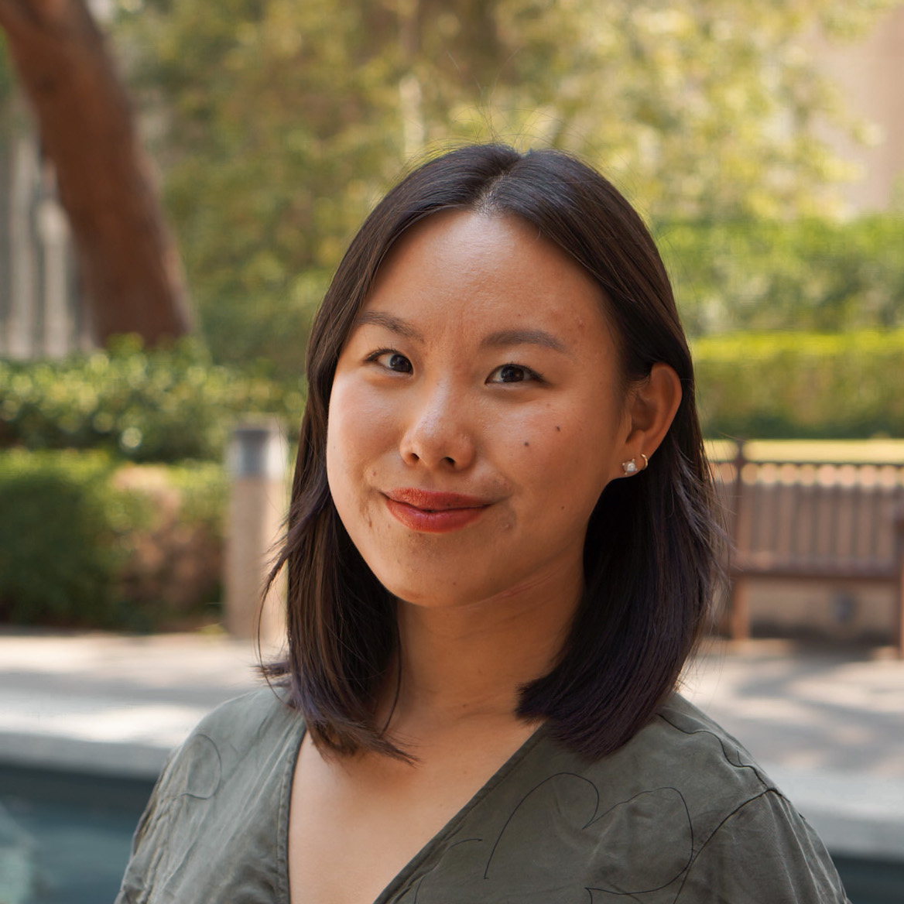

I am currently the CTO/cofounder of [Fearn](https://fearn.ai). Previously, I received my PhD in [Computing and Mathematical Sciences](https://www.cms.caltech.edu/) from [Caltech](https://www.caltech.edu/), where I had the pleasure of being advised by [Professor Katie Bouman](https://users.cms.caltech.edu/~klbouman/). Before that, I received a B.S. in Electrical and Computer Engineering with an additional major in Biomedical Engineering from [Carnegie Mellon University](https://www.cmu.edu/).

My research focuses on generative models, machine learning, and inverse problems: methods that integrate physics-based models with data-driven approaches, applied to domains from seismic tomography to black hole imaging.

Click [here](/assets/Angela_Gao_CV_F23.pdf) for a PDF of my CV.

## Selected Publications

**AF Gao**, JD Wilding, E Biondi, KL Bouman, and ZE Ross. High-resolution Eikonal-based Traveltime Tomography and Uncertainty Quantification of the Kilauea Caldera. *Geophysical Journal International*, 2026. [[Paper]](https://doi.org/10.1093/gji/ggag179) [[arxiv]](https://arxiv.org/abs/2507.23692)

O Leong\*, **AF Gao**\*, H Sun, and KL Bouman. Discovering Structure From Corruption for Unsupervised Image Reconstruction. *IEEE Transactions on Computational Imaging*, 2023. [[arxiv]](https://arxiv.org/abs/2304.05589) [[Project Website]](http://imaging.cms.caltech.edu/igm/) [[code]](https://github.com/angelafgao/IGM)

**AF Gao**, J Castellanos, Y Yue, ZE Ross, and KL Bouman. DeepGEM: Generalized Expectation-Maximization for Blind Inversion. *Advances in Neural Information Processing Systems (NeurIPS)*, 2021. [[Paper]](https://proceedings.neurips.cc/paper/2021/hash/606c90a06173d69682feb83037a68fec-Abstract.html) [[Project Website]](http://imaging.cms.caltech.edu/deepgem/) [[code]](https://github.com/angelafgao/DeepGEM)

Y Yang\*, **AF Gao**\*, JC Castellanos\*, ZE Ross, K Azizzadenesheli, and RW Clayton. Seismic Wave Propagation and Inversion with Neural Operators. *The Seismic Record*, 2021. [[Paper]](https://pubs.geoscienceworld.org/ssa/tsr/article/1/3/126/609317/Seismic-Wave-Propagation-and-Inversion-with-Neural) [[arxiv]](https://arxiv.org/abs/2108.05421)

\* denotes equal contribution. [All publications →](/Publications/)

