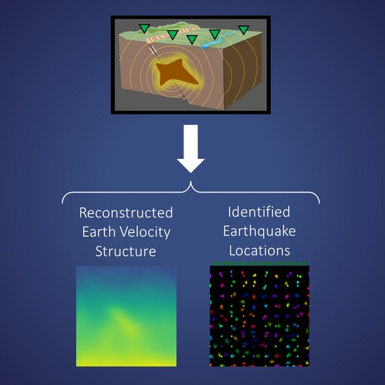
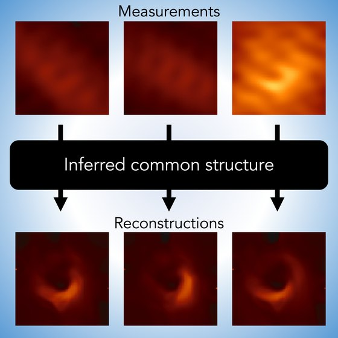
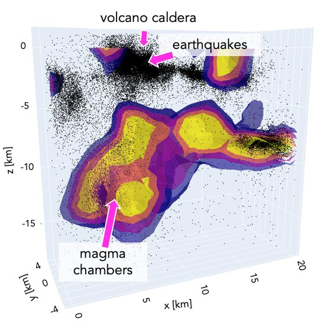
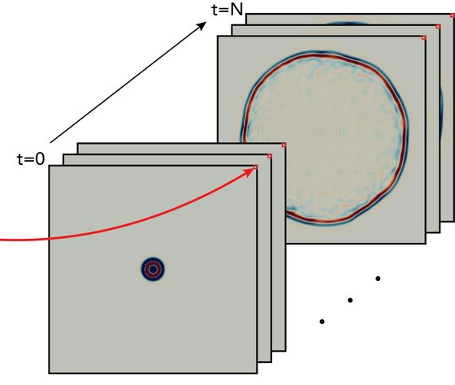
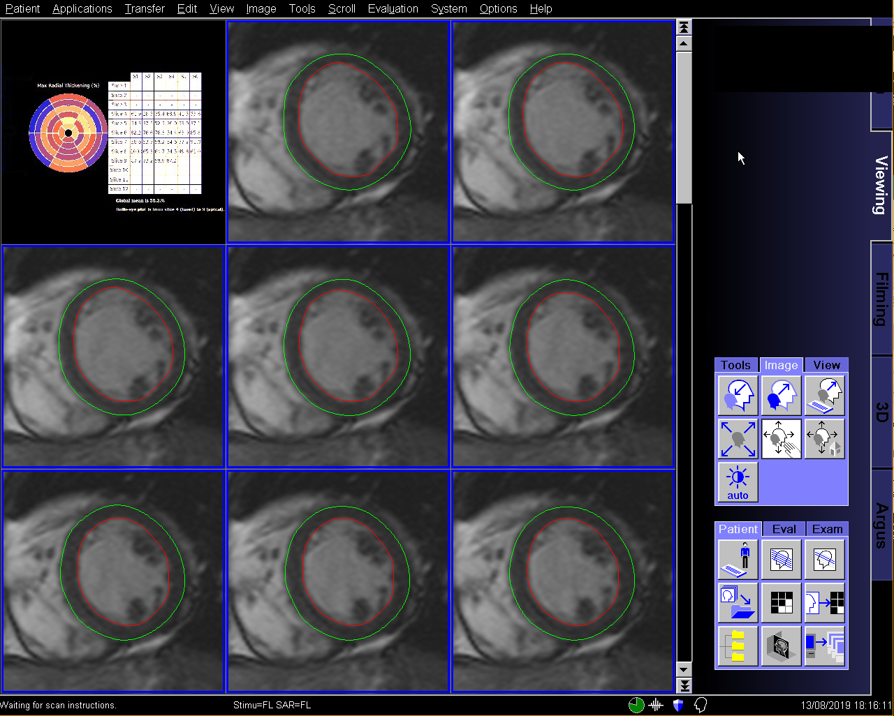
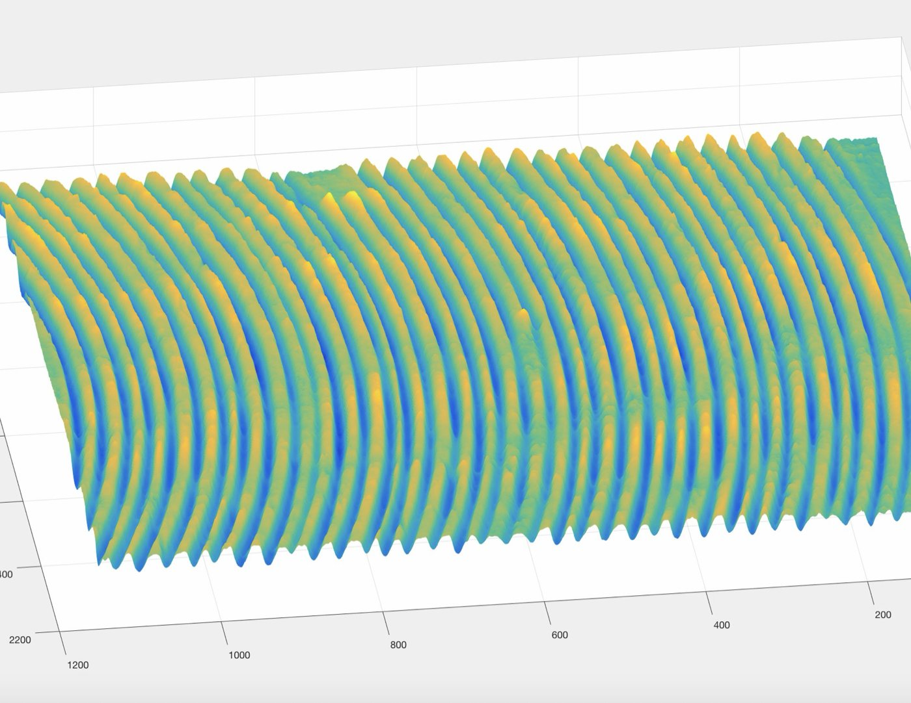

My research develops methods for imaging problems where measurements are indirect, noisy, or incomplete, and where the forward model itself may be uncertain. I combine physics-based models with deep generative models to uncover hidden structure in data, with applications from seismic tomography to black hole imaging. My PhD thesis, [*Uncovering Hidden Structure in Data and the Physical World for Seismic Tomography and Beyond*](https://thesis.library.caltech.edu/18608/), brings this work together.

## Projects

<article class="project">
  
  

  <h3 class="project-title">DeepGEM: Generalized Expectation-Maximization for Blind Inversion</h3>
  
NeurIPS 2021 · JGR: Solid Earth 2025

  

Most inverse problems assume the forward model is known exactly. DeepGEM solves *blind* inverse problems, recovering both the hidden source and unknown forward model parameters without supervision, using a variational expectation-maximization framework built on normalizing flows. On blind seismic tomography it significantly outperforms the standard method used in seismology. Follow-up work, [DeepGEM-EGF](https://doi.org/10.1029/2025JB031260), applies the framework to jointly estimate earthquake source-time functions and empirical Green's functions with uncertainty.

  

  

    <a href="https://imaging.cms.caltech.edu/deepgem/">Project page</a>
    <a href="https://proceedings.neurips.cc/paper/2021/hash/606c90a06173d69682feb83037a68fec-Abstract.html">Paper</a>
    <a href="https://github.com/angelafgao/DeepGEM">Code</a>
  

  

</article>

<article class="project">
  
  

  <h3 class="project-title">Image Reconstruction Without Explicit Priors</h3>
  
ICASSP 2023 · IEEE TCI 2023 · ICASSP 2024

  

Image priors are essential for ill-posed inverse problems, but many scientific applications have no example images to learn them from. Instead, we reconstruct a *set* of images jointly, learning a shared image generator directly from corrupted measurements. As few as 150 measurement examples are enough for prior-free reconstruction, from denoising and phase retrieval to recovering a video of the evolving black hole M87*.

  

  

    <a href="https://imaging.cms.caltech.edu/igm/">Project page</a>
    <a href="https://arxiv.org/abs/2304.05589">TCI paper</a>
    <a href="https://arxiv.org/abs/2303.12217">ICASSP 2023</a>
    <a href="https://doi.org/10.1109/ICASSP48485.2024.10445896">Black hole video</a>
    <a href="https://github.com/angelafgao/IGM">Code</a>
  

  

</article>

<article class="project">
  
  

  <h3 class="project-title">Imaging Kilauea's Magmatic System</h3>
  
Geophysical Journal International 2026

  

A stochastic eikonal tomography method with per-pixel uncertainties estimated through variational inference. It produces a 3D reconstruction of the magmatic system beneath Kilauea at previously unattained resolution, revealing a columnar high-velocity-ratio region beneath the caldera and constraining its melt fraction.

  

  

    <a href="https://doi.org/10.1093/gji/ggag179">Paper</a>
    <a href="https://arxiv.org/abs/2507.23692">arXiv</a>
  

  

</article>

<article class="project">
  
  

  <h3 class="project-title">Neural Operators for Seismology</h3>
  
The Seismic Record 2021 · IEEE TGRS 2023 · TMLR 2024

  

Neural operators learn solution maps for whole families of PDEs, making seismic wave simulation and full-waveform inversion far faster than traditional numerical solvers. Building on this, OpFlow extends normalizing flows to function spaces for functional regression with uncertainty quantification.

  

  

    <a href="https://pubs.geoscienceworld.org/ssa/tsr/article/1/3/126/609317/Seismic-Wave-Propagation-and-Inversion-with-Neural">Wave propagation</a>
    <a href="https://arxiv.org/abs/2209.11955">Waveform inversion</a>
    <a href="https://arxiv.org/abs/2404.02986">OpFlow</a>
  

  

</article>

## Earlier Research

<article class="project">
  
  

  <h3 class="project-title">AI-Powered Inline Cardiac Strain Mapping</h3>
  
NIH NHLBI · Summer 2019

  

With Dr. Peter Kellman and Dr. Hui Xue at the [NIH NHLBI](https://www.nhlbi.nih.gov/), I computed myocardial strain from cardiac MR scans, using DenseUNets to segment myocardial tissue and implementing the strain calculation in C++ for the Gadgetron scanner pipeline.

  

  

</article>

<article class="project">
  

  <h3 class="project-title">Single-Shot Illumination Source Separation</h3>
  
Carnegie Mellon University · 2018–2019

  

In the [Image Science Lab](https://imagesci.ece.cmu.edu/) with [Prof. Aswin Sankaranarayanan](https://users.ece.cmu.edu/~saswin/), I separated illumination sources from a single image using physics-motivated deep networks that learn the components of the image formation model: albedo, reflectivity, and shading.

  

  

</article>

<article class="project">
  
  

  <h3 class="project-title">3D Reconstruction of Sonorines with Photometric Stereo</h3>
  
Princeton University · Summer 2017

  

With [Prof. Adam Finkelstein](https://www.cs.princeton.edu/~af/) and [Prof. Szymon Rusinkiewicz](https://www.cs.princeton.edu/~smr/), I developed photometric stereo methods to reconstruct the 3D shape of sonorines, delicate plaster records.

  

  

</article>

## Resources

- [ehtim tutorial](https://github.com/helloquat/ehtim-tutorial), led by [Yvette Lin](https://github.com/helloquat): how to use the [ehtim](https://achael.github.io/eht-imaging/) package to simulate your own black hole measurements.
